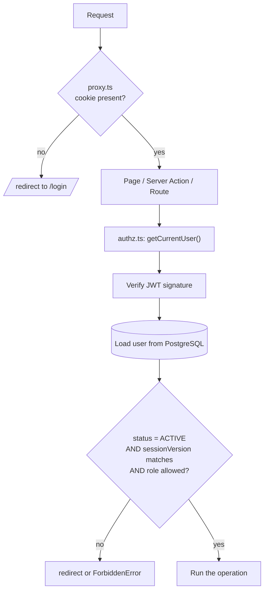
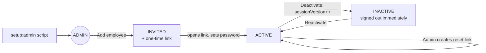
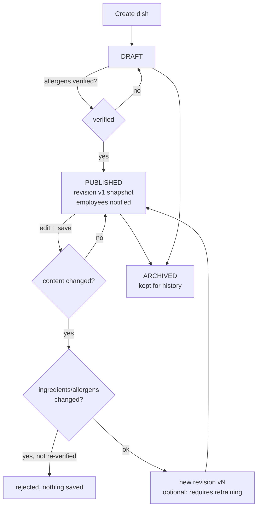

# Staff Training Platform

A single-restaurant web app that trains waiters on the menu: dishes, ingredients, allergens, preparation and
service knowledge, with quizzes and progress tracking for the manager.

**One deployment = one restaurant = one PostgreSQL database.** There is no multi-tenancy, no public sign-up and
no billing. To serve another restaurant, deploy another copy with its own database and environment variables.

Stack: Next.js 16 (App Router) · TypeScript (strict) · Tailwind CSS 4 · Prisma 7 + PostgreSQL · Auth.js · Zod · Vercel Blob · Vitest

## Status

| Phase | Scope | State |
|---|---|---|
| 1 | Foundation: schema, auth, roles, admin bootstrap | ✅ done |
| 2 | Admin: settings, categories, ingredients/allergens, dishes + revisions, photos, employees | ✅ done |
| 3 | Learning: employee dashboard, dish pages, study acknowledgement, quiz builder, quiz taking + grading | ⏳ next |
| 4 | Tracking: progress, manager performance dashboard + CSV, retraining flow, notifications UI | ⏳ |
| 5 | Production hardening and deployment polish | ⏳ |

The database schema already contains the tables for all phases (quizzes, attempts, study progress, notifications).

## Local setup

```bash
npm install
cp .env.example .env            # fill DATABASE_URL and AUTH_SECRET (openssl rand -base64 32)
npm run db:migrate              # creates tables (prisma migrate dev)
npm run setup:admin             # creates the first manager account (prompts for password)
npm run dev                     # http://localhost:3000
```

`npm run setup:admin` also creates the settings row and the 14 standard allergens. It never ships a default
password: supply `ADMIN_NAME` / `ADMIN_EMAIL` / `ADMIN_PASSWORD` as env vars or type them at the prompt.

Photo uploads need `BLOB_READ_WRITE_TOKEN` (Vercel → Storage → Blob). Without it everything else works and the
upload button explains that storage is not configured. No files are ever written to local disk.

## Scripts

| Command | What it does |
|---|---|
| `npm run dev` / `build` / `start` | Next.js |
| `npm test` | Vitest integration tests against a real PostgreSQL (`TEST_DATABASE_URL`, default `lokal_test`) |
| `npm run typecheck` / `lint` | `tsc --noEmit` / ESLint |
| `npm run db:migrate` / `db:deploy` | Create+apply (dev) / apply only (production) migrations |
| `npm run setup:admin` | Create an administrator |

Tests: create the database once (`createdb lokal_test`); migrations are applied automatically by the test runner.

## Deploying to Vercel (per restaurant)

1. Create a managed PostgreSQL database (Neon, Vercel Postgres, Supabase, …). Copy both connection strings:
   the **pooled** one (`DATABASE_URL`, used by the running app) and the **direct** one (`DIRECT_URL`, used only for migrations).
2. Create a Vercel project from this repo and add a **Blob** store (gives `BLOB_READ_WRITE_TOKEN`).
3. Set environment variables (see `.env.example`): `DATABASE_URL`, `DIRECT_URL`, `AUTH_SECRET`, `AUTH_URL`
   (the public URL, used to build invite links), `AUTH_TRUST_HOST=true`, `BLOB_READ_WRITE_TOKEN`.
4. Deploy. The `vercel-build` script runs `prisma migrate deploy` before `next build`.
5. Create the first manager once, from your machine, pointed at the production database:
   `DATABASE_URL="<direct url>" npm run setup:admin`
6. Sign in, open **Settings** (name, logo, language), then add categories, dishes and employees.

## How it works

### Request security: the database is the authority



The proxy is only a fast redirect. A forged role claim, a deactivated user, or a password change is caught by the
database check on every page and every server action. A test calls every admin action as an anonymous user and
as an employee and asserts that all are refused with zero writes.

### Account lifecycle



Invite and reset links are single-use, expire (7 days / 24 hours), and only a SHA-256 hash is stored.

### Dish publishing and revisions



Allergen and dietary information is never generated or inferred. A manager enters it and attests to it, and any
safety-relevant change to a live dish requires a fresh attestation.

## Project layout

```
prisma/            schema, migrations (incl. hand-written DB constraints), seed
scripts/           create-admin.ts
src/auth*.ts       Auth.js (edge-safe config + credentials provider)
src/proxy.ts       coarse route gate (Next 16 "proxy", formerly middleware)
src/lib/           authz, tokens, rate-limit, uploads, validation, services/ (all business logic)
src/app/           routes: (auth)/login, set-password, admin/*, employee/*
src/components/    ui primitives, layout shells, forms
tests/             integration tests (real PostgreSQL)
```

Business rules live in `src/lib/services/*` (pure functions over Prisma, tested directly). Server actions are thin:
assert role → validate → call service → revalidate.
