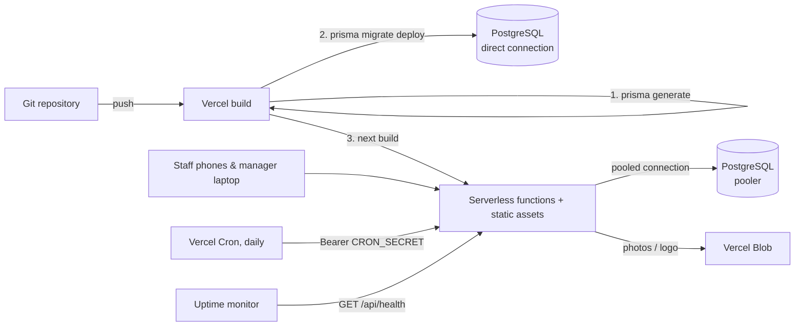

# Deployment guide

One deployment serves **one restaurant**. To onboard another restaurant, repeat this guide with a new Vercel
project and a new database. The code never changes.



## 1. What you need

| Item | Notes |
|---|---|
| Vercel account | Hobby works for one small restaurant; Pro for production SLAs. |
| Managed PostgreSQL 14+ | Neon, Vercel Postgres (Neon), Supabase *as a plain Postgres host*, RDS, etc. |
| This repository | Fork or import it into Vercel. |
| Node 20.9+ locally | Only for the one-time admin creation step. |

## 2. Database

Create an empty database and collect **two** connection strings for the same database:

| Variable | Which string | Used by |
|---|---|---|
| `DATABASE_URL` | **Pooled** (PgBouncer / Neon pooler: host often contains `-pooler`, Supabase port `6543`) | The running app. Serverless functions open many short-lived connections; the pooler protects the database. |
| `DIRECT_URL` | **Direct / non-pooled** | `prisma migrate deploy` during the build (migrations need session-level features that poolers can break). |

If your provider has no pooler, use the same string for both. The app keeps at most 5 connections per function
instance (`DATABASE_POOL_MAX` to change). Add `?sslmode=require` when the provider requires TLS.

## 3. Vercel project

1. **Import** the repository as a new project. Framework: Next.js (auto-detected). `vercel.json` already sets
   the build command (`npm run vercel-build` = `prisma generate && prisma migrate deploy && next build`) and the daily cleanup cron.
2. **Storage → Create → Blob.** Connect it to the project; this adds `BLOB_READ_WRITE_TOKEN`.
3. **Environment variables** (Production, and Preview if you use previews):

| Name | Required | Value |
|---|---|---|
| `DATABASE_URL` | yes | Pooled connection string |
| `DIRECT_URL` | yes\* | Direct connection string (\*or omit to reuse `DATABASE_URL`) |
| `AUTH_SECRET` | yes | `openssl rand -base64 32`. Unique per restaurant. Rotating it signs everyone out. |
| `AUTH_URL` | yes | Public URL, e.g. `https://trattoria-rossi.vercel.app` or your custom domain. Used to build invite and reset links. |
| `AUTH_TRUST_HOST` | yes | `true` |
| `BLOB_READ_WRITE_TOKEN` | for photos | Added by the Blob integration |
| `CRON_SECRET` | recommended | Any random string of 16+ characters. Vercel sends it to the cleanup cron automatically. |
| `DATABASE_POOL_MAX` | no | Default `5` |

The app validates these at startup. A missing or malformed critical value stops the deployment with a message in
the function logs that names the variable; weaker problems (e.g. `AUTH_URL` pointing at localhost) are logged as warnings.

4. **Deploy.** The first build creates all tables.

## 4. Create the first manager (once)

There is no public registration and no default password. Choose one of two ways.

### Option A: in the browser (no command line)

1. In Vercel add an environment variable `SETUP_TOKEN` with a long random value (24+ characters; e.g. `openssl rand -base64 32`) and **redeploy**.
2. Open `https://<your-site>/setup`, enter the token, your name, email and a password.
3. You land on the sign-in page. The `/setup` page now returns 404 for good (it disappears as soon as any manager exists), and you can delete `SETUP_TOKEN`.

Without `SETUP_TOKEN` the page does not exist, so nobody can claim the manager account by finding the URL first. Attempts are rate-limited and the token is compared in constant time.

### Option B: command line

From a checkout of the repository on your machine:

```bash
npm ci
DATABASE_URL="<DIRECT_URL value>" npm run setup:admin
# prompts for name, email and password (input hidden); also creates the settings row and the 14 standard allergens
```

Then sign in at your site, open **Settings** and fill in the restaurant name, logo and language.
Run the command again to add a second manager. Managers create employees; employees cannot become managers.

**Lost a manager password?** (There is no email flow for managers.)

```bash
DATABASE_URL="<DIRECT_URL value>" npm run admin:reset-password
```

This sets a new password, re-activates the account and signs that manager out everywhere.

## 5. Go-live checklist

- [ ] `https://<site>/api/health` returns `{"status":"ok"}`
- [ ] Sign in as the manager; Settings saved; a **logo upload** works (confirms Blob)
- [ ] Create a category, a dish with allergens, tick the verification box, publish
- [ ] Build a quiz for it and publish
- [ ] Add a test employee, open the invite link on a phone, set a password, study the dish, take the quiz
- [ ] The manager sees the result under **Training Results**; CSV export downloads
- [ ] Deactivate the test employee: their session ends immediately
- [ ] Vercel → project → Cron Jobs shows `/api/cron/cleanup`; run it once and check it returns `ok`
- [ ] Add `/api/health` to an uptime monitor
- [ ] Enable **backups / point-in-time recovery** at your database provider (the app stores nothing else of value)
- [ ] Custom domain added in Vercel **and** `AUTH_URL` updated to it (then redeploy)

## 6. Day-2 operations

**Updating the app.** Merge to the production branch. The build applies new migrations before switching traffic.
Migrations are forward-only, so keep schema changes backward compatible for one release (add columns / tables first,
remove them in a later release). An instant rollback in Vercel restores the previous code but *not* the database;
if a release included a destructive migration, restore from a database backup instead.

**Preview deployments** should use a separate database (never the production one) because every build runs `migrate deploy`.

**Backups.** Training records are the product. Use your provider's automated backups with point-in-time recovery,
and test a restore once. Uploaded images live in Vercel Blob (not in the database).

**Housekeeping.** The daily cron deletes expired rate-limit counters, used/expired invite and reset tokens
(30 days), read notifications (180 days) and never-submitted quiz attempts (30 days). It never deletes
submitted attempts, study records or dish/quiz revisions.

**Rotating secrets.** `AUTH_SECRET`: change it and redeploy, which signs everyone out. Database password: rotate at the
provider, update `DATABASE_URL` / `DIRECT_URL`, redeploy. `BLOB_READ_WRITE_TOKEN`: regenerate in Vercel Storage.

**Time zones.** Dates in filters and CSV exports use UTC days. Times shown on screen follow the viewer's browser.

**Monitoring.** Vercel → Logs for runtime errors. Users who hit an error see a reference code (the error digest) you can search for.

## 7. Onboarding another restaurant

1. New Vercel project from the same repository (or a branch you maintain for that client)
2. New empty database, new Blob store, new `AUTH_SECRET`, new `CRON_SECRET`
3. Sections 3 to 5 above
4. Nothing is shared between deployments: users, menus, quizzes and results are fully separate

## 8. Troubleshooting

| Symptom | Likely cause |
|---|---|
| Build fails at `prisma migrate deploy` | `DIRECT_URL` wrong, or it points at a pooler. Use the direct string. |
| Every page shows "Something went wrong" | Check function logs for `Invalid environment configuration`. |
| Invite links point to the wrong domain | `AUTH_URL` missing or outdated. |
| Upload says "Image storage is not configured" | `BLOB_READ_WRITE_TOKEN` missing. |
| Everyone is signed out after a deploy | `AUTH_SECRET` changed. |
| "Too many attempts" at login | Rate limit (8 failures per account / 30 per IP per 15 min); wait or clear the `RateLimit` table row. |
| Cleanup cron returns 401 | `CRON_SECRET` is not set on the project. |
